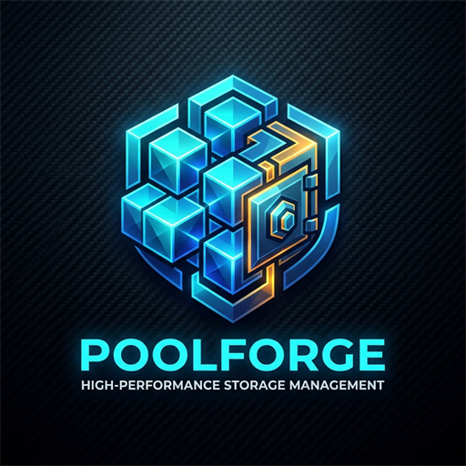

<p align="center">
  
</p>

<h1 align="center">DriveSpanner</h1>

<p align="center">
  <strong>A high-performance storage pool daemon and modern management application for Windows.</strong>
</p>

<p align="center">
  
  
  
  
</p>

DriveSpanner aggregates multiple physical hard drives, SSDs, and storage volumes into a **single unified virtual drive letter** (e.g. `V:\`), while preserving the critical invariant: **files reside wholly and natively on individual member disks without RAID striping**.

---

## Key Features

1. **Zero Striping / Pure NTFS & exFAT Preservation**:
   - Files are stored completely inside standard `PoolData.<pool-id>` folders on each underlying disk.
   - If a drive is removed or connected to any other Windows machine, all files remain immediately accessible and readable in plain NTFS/exFAT without special recovery software.

2. **Single Unified Virtual Drive (WinFsp Kernel Driver)**:
   - Mounts the aggregated pool as a standard Windows drive letter (e.g. `V:\`).
   - Seamless directory merging across member disks: replicas appear only once in Explorer.
   - Real-time aggregation of free space and volume capacity using `GetDiskFreeSpaceExW`.
   - Kernel-level caching and high-concurrency dispatching.

3. **High-Speed SSD Cache Tier & Pinned Fast Cache (Landing Zone)**:
   - Add fast SSD drives as dedicated landing zones where new writes land first for maximum ingest speed.
   - **Isolated Storage Pool Capacity**: SSD Cache drives do not participate in normal pooled capacity calculations or rebalancing.
   - **Automated Cache Mover**: Intelligent background mover migrates aged files to mechanical array HDDs when fullness threshold is met (e.g., 80%).
   - **Pinned Fast Cache Folders**: Pin specific directories (such as `/Music` or `/Photos`) permanently to the SSD Cache so files start instantaneously without waiting for mechanical hard drives to spin up.
   - **Full HDD Array Duplication**: Pinned folders are simultaneously replicated across your array HDDs (e.g. 2x or 3x copies) for high resilience. The cache mover preserves pinned SSD copies while ensuring full redundancy on persistent disks.
   - **Background Synchronization**: Automatically syncs existing folder files from mechanical HDDs to the SSD cache on service startup or on-demand via the Web Dashboard.

4. **Plex "Continue Watching" & Spindown Prevention**:
   - Integrated with Plex Media Server (`/library/onDeck`): titles in "Continue Watching" are served directly from the SSD cache.
   - **Zero HDD Spinup Latency**: Mechanical hard drives remain in low-power spindown sleep during media playback.
   - **Next Episode Pre-caching**: Automatically detects and pre-caches the upcoming episode in TV series (e.g. S01E05 after S01E04) for uninterrupted binge-watching.
   - **Automatic Watched Episode Eviction**: Once an episode has been watched, it is safely verified on the persistent HDD storage array, removed from the SSD cache drive, and VFS routing is refreshed to free up SSD space.
   - Configurable tick box options in the Web Dashboard settings.

5. **SMB Network Share Preservation on Upgrade**:
   - Seamless upgrades: holds active SMB connections in a wait state (`net pause LanmanServer`) instead of aborting TCP sessions with a hard reset.
   - Automatically preserves and restores Windows network shares (`\\SERVER\Share` -> `V:\`) upon service remount.
   - Attached Docker containers, media players, and network client apps stay connected without requiring manual re-shares.

6. **Per-Folder Duplication & Segregation**:
   - Configurable per-folder replica rules (e.g., `/Documents` 2x, `/Family Photos` 3x).
   - **Strict physical segregation**: Replica copies of a file are guaranteed to live on distinct, independent physical disks.
   - Background resilvering scrub automatically detects missing or degraded copies and restores full redundancy.

7. **Intelligent Drive Balancing**:
   - Automatic and manual balancing routines to distribute data evenly across member disks.
   - Safe 3-step atomic migrations (copy -> verify size -> clean source).
   - Replica-aware: Balancing will never migrate a file to a disk that already holds a copy of that file.

8. **Modern Web Dashboard & Network Security**:
   - Embedded web interface accessible at `http://localhost:8989`.
   - First-time setup wizard prompts for an Administrator password to protect the dashboard and REST APIs across your local network.
   - Dedicated tabs for Overview & Disks, Folder Replication, Drive Balancer, Pool Explorer, Service Control, and **SSD Cache & Settings**.
   - Zero external runtime dependencies: static HTML, CSS, and JS are embedded directly into the executable binary.

9. **Automated Updates & Production Installer**:
   - Background GitHub Release polling automatically notifies you in the Web UI whenever a new version of DriveSpanner is released.
   - Installs as an automatic Windows Service (`DriveSpannerService`) that starts at boot time.
   - Standalone WiX `.msi` installer prompting for elevated administrative privileges with built-in reboot suppression.

---

## Installation & Packaging

### Standalone MSI Installer
The recommended way to install DriveSpanner is using the MSI installer generated by GitHub Actions:
1. Download `DriveSpanner-1.4.1-Setup.msi` from [Releases](https://github.com/chrisurwin/drivespanner/releases).
2. Run the MSI. The installer checks for the required WinFsp filesystem driver (prompting to install WinFsp automatically if absent).
3. On upgrades, active SMB connections are put in a wait state, shares are backed up, the new service is installed, and shares are restored without rebooting.
4. DriveSpanner installs to `%ProgramFiles%\DriveSpanner\` and automatically starts as a Windows Service at boot.
5. Open `http://localhost:8989` to set your administrator password and start pooling drives.

### Automated CI/CD
Every push to `main` or tag `v*` triggers the automated GitHub Actions workflow (`.github/workflows/build-and-release.yml`), which compiles the Rust binary, packages the WiX MSI installer, and uploads the artifacts and releases automatically.

---

## CLI Usage

| Command | Description |
| :--- | :--- |
| `drivespanner run` | Starts the daemon in the foreground (Web UI on `http://localhost:8989`, API, and VFS dispatcher) |
| `drivespanner status` | Displays CLI summary of pool health, member disks, replication count, and balance variance |
| `drivespanner add <PATH> [--landing-zone]` | Adds a physical drive or folder into the storage pool (mark as SSD cache with `--landing-zone`) |
| `drivespanner mount [LETTER]` | Mounts the virtual filesystem drive letter (default: `V:`) |
| `drivespanner unmount` | Stops the service and unmounts the virtual drive |
| `drivespanner upgrade-prepare` | Discovers active SMB shares, pauses LanmanServer into wait state, and unmounts pool before upgrade |
| `drivespanner upgrade-resume` | Starts service, remounts virtual pool, restores SMB shares, and resumes LanmanServer |
| `drivespanner set-mount <LETTER>` | Updates the virtual filesystem mount drive letter in configuration |
| `drivespanner service install` | Registers DriveSpanner as an automatic Windows Service (`sc.exe create`) |
| `drivespanner service uninstall` | Stops and removes the Windows Service |
| `drivespanner service start` | Starts the Windows Service |
| `drivespanner service stop` | Stops the Windows Service |
| `drivespanner service run` | Runs inside the Windows Service Control Manager (SCM) dispatcher |

---

## Configuration (`config.json`)

DriveSpanner stores configuration in `%ProgramFiles%\DriveSpanner\config.json`:

```json
{
  "pool_id": "default-pool",
  "pool_name": "DriveSpanner Storage",
  "mount_point": "V:",
  "member_drives": [],
  "cache": {
    "enabled": true,
    "min_file_age_minutes": 15,
    "move_threshold_percent": 80.0,
    "plex": {
      "enabled": true,
      "precache_next_episode": true,
      "server_url": "http://localhost:32400",
      "token": "",
      "sync_interval_minutes": 15,
      "max_cache_gb": 50
    }
  },
  "replication": {
    "default_replicas": 2,
    "rules": []
  },
  "balancer": {
    "strategy": "equalize_percentage",
    "auto_balance": true,
    "imbalance_threshold_percent": 15.0,
    "schedule_interval_minutes": 60,
    "rate_limit_mb_per_sec": 0
  },
  "api": {
    "host": "0.0.0.0",
    "port": 8989,
    "auth_enabled": true,
    "password_hash": "",
    "session_secret": "",
    "session_token": ""
  },
  "updates": {
    "check_enabled": true,
    "github_repo": "chrisurwin/drivespanner",
    "check_interval_hours": 24
  }
}
```

---

## Architecture

- **`src/core/disk.rs`**: Drive discovery, volume interrogation via Windows Win32 APIs (`GetDiskFreeSpaceExW`, `GetVolumeInformationW`), and `PoolData` path translation.
- **`src/core/placement.rs`**: Placement policies including `LandingZoneFirst` targeting SSD cache, and replica segregation excluding transient cache drives.
- **`src/core/plex.rs`**: Plex On-Deck media querying, TV next-episode detection, SSD pre-caching engine, and cache mover eviction protection.
- **`src/core/replication.rs` & `src/core/replicator.rs`**: Per-folder rule matching, async background resilvering queue, and scrub orchestrator.
- **`src/core/balancer.rs`**: Multi-drive imbalance calculation and 3-step atomic file migration engine (SSD cache excluded).
- **`src/core/updater.rs`**: Background update check service polling GitHub Releases API.
- **`src/service/smb.rs`**: SMB share discovery, LanmanServer pause/resume wait-state management, and automated share restore.
- **`src/vfs/`**: WinFsp FUSE dynamic loader, kernel caching, and virtual filesystem dispatcher with cache-first read prioritization.
- **`src/api/auth.rs`**: Secure PBKDF2/SHA-256 password hashing, rate limiting, and session management.
- **`src/api/routes.rs`**: Axum REST API server serving live metrics, cache endpoints, update endpoints, and embedded web assets.
- **`src/service/`**: Windows Service Control Manager native dispatcher (`windows-service`).
- **`src/web/`**: Modern dashboard web assets with dark theme, SSD Cache & Settings controls, and live responsive metrics.
- **`wix/`**: WiX Toolset installer source (`drivespanner.wxs`), prerequisite scripts, and build automation.
